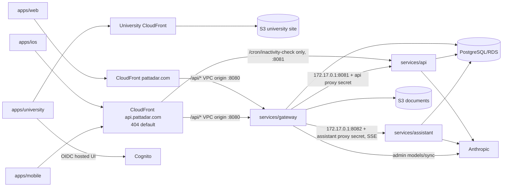

# Current Pattadar System Map

Verified from repository source/config on 09/10/2026, and the runtime topology
on 26/10/2026 (Design A, code only; `docs/specs/2026-10-26-one-server-runtime.md`).
This is declared architecture, not proof of applied AWS state.

## Client and service roles

- `apps/web`: shipping React/MUI/Vite SPA with public/auth/legal pages, active
  W360 app, public share/work portals, account data, assistant panel, and a
  retained `/legacy` shell.
- `apps/ios`: active SwiftUI/PattadarKit client; parity through vectors/contracts.
- `apps/mobile`: implemented Expo Router compatibility client; generated
  `ios/`/`android/` trees are not source.
- `apps/university`: Pattadar University content application; included in the
  Bun workspace, build, and unit-test gates.
- `packages/core`: TypeScript API/network/domain/format/export logic.
- `packages/tokens`: shared web/mobile design tokens (runtime mobile imports
  should be verified when relevant).
- `services/gateway`: public JWT boundary, immutable-principal mapping, storage,
  capabilities/account/admin routes, buffered API proxy, streaming assistant proxy.
- `services/api`: FastAPI + Strawberry product/W360 domains; trusts gateway
  `x-user-id`; cron is the single direct path (the api distribution's exact-path
  behaviour to the api VPC origin) protected by `CRON_SECRET`. Its container
  entry `src/private_ingress.py` refuses everything else without the gateway's
  `INTERNAL_PROXY_SECRET`.
- `services/assistant`: authenticated SSE chat, durable conversation/run state,
  bounded tools, owner-scoped attachments, optional read-only public records.

## Main request topology

## Public and capability entry points

Ingress that needs no Bearer or skips the API proxy. Check a new one against
the control that guards it:

- Anonymous GraphQL roots: two allowlists, gateway
  `services/gateway/src/public_graphql.py` (`is_public_verification`) and API
  `services/api/src/main.py` (`public_queries`/`public_mutations`). A new root
  must be added to both; today the API also admits `trainingCertificate`, so
  flag any other difference.
- Capability links: `services/gateway/src/routes/capabilities.py`; the token
  is the credential and the API resolves its scope before any storage call.
- `POST payments/webhook`: passed through unauthenticated, guarded only by the
  Razorpay HMAC in `services/api/src/payments.py`.
- Direct upload: presigned POST to a gateway-chosen pending key (the policy
  pins type and size range), then HeadObject re-reads the size before the file
  row exists (`services/gateway/src/storage.py`).
- `/internal/*`: refused by the proxy (`_private_path` in
  `services/gateway/src/routes/proxy.py`). In the container the API's
  `private_ingress` wrapper requires `x-internal-proxy-secret` on every path
  except `/health` and the cron path, and refuses to start without it unless
  `ALLOW_INSECURE_LOCAL=1`. The local stack runs `src.main:app` directly, where
  the inner check still fails open while `INTERNAL_PROXY_SECRET` is unset. The
  gateway sends per-target secrets (`INTERNAL_PROXY_SECRET_API`,
  `INTERNAL_PROXY_SECRET_ASSISTANT`); `deploy-release.py` refuses a release
  without them or with `ALLOW_INSECURE_LOCAL`.

## Persistent/runtime split

Persistent: KMS, S3 documents/logs/village maps (`/vm/*`, served by runtime
CloudFront), ECR, Secrets Manager, Cognito, DNS/SES,
CloudTrail/Config/GuardDuty, GitHub OIDC. Out of band (neither root): the five
app SSM SecureStrings `/pattadar/<env>/*`. Runtime: VPC/public subnets (no
NAT), one ECS host (EC2 t4g.medium; `ec2.tf`) running the gateway, api and
assistant as bridge-mode tasks on host ports 8080/8081/8082, the api
CloudFront distribution and VPC origins (`api_edge.tf`), non-public RDS, SPA
CloudFront/WAF, scheduler, logs/alarms/SNS. Runtime reads persistent outputs
through remote state and is recreated by reviewed lifecycle scripts. There is
no ALB, Fargate or Service Connect.

The `web` ECS service, task and target group were removed on 26/10/2026;
`aws_iam_role.web_task`, the `web` ECR repo and the dead `web_*` variables
remain. The `web_origin` variable (default `spa`) and `deploy.yml`'s
`--web-origin spa` must stay `spa`.

University (`infra/terraform/envs/prod/university`) is a third, standalone
root: always on, no dev twin, outside platform-up/down. `deploy-university.yml`
publishes the site from its outputs but never applies it. It owns its own S3
site, ACM, optional WAF, CloudFront (S3 origin, GET/HEAD only) and Cognito client, reads
persistent outputs (Cognito pool/issuer/hosted UI domain, Route 53 zone), and
calls no Pattadar API.

## Feature domains

Auth/identity; public/auth/legal routes; portfolio/record 360; holdings
(`/holdings`; server `combined_*`) (a W360-only aggregate OVER parcel/property records — its own tables,
name, membership and whole-holding costs; never in `_cards`, never in portfolio
totals, and it merges no boundary or title); legacy land
records; families/groups/beneficiaries; vault/storage/reader; durable AI import;
maps/FMB/village/reference ingestion; photos/features; services/orders/tickets;
associate desk; wallet/payments; scoped shares/capabilities; assistant/model
catalog; notifications/cron; account consent/export/erasure; reference data,
fees, and audit.

## Invariants

Gateway-derived identity; one secret-guarded direct cron path, plus a
gateway-only proxy secret on the shared host; immutable
issuer/subject identity; durable non-replayed AI work; server-side authority;
scoped public tokens; verbatim storage keys; persistent/runtime separation;
exact-revision release; additive compatibility; DD/MM/YYYY; implemented is not
deployed.
