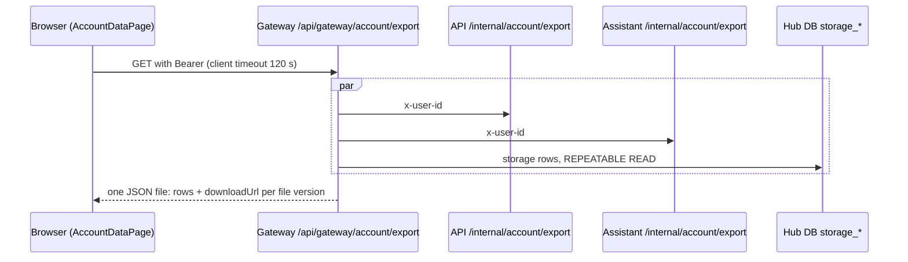

# Gap analysis: back up, delete and restore my data

**Requirements addendum:** `/Users/reddy.sh/reddy.sh/projects/pattadar-platform/.agents/tasks/account-backup-delete-restore/requirements-addendum.md`

> **Requirements addendum R6–R8 (absolute path above). Every later step must apply it.**
> R9 (page lead copy, added to the same file on 09/10/2026) carries the same weight.
> R6–R9 are copied verbatim in Appendix A. §8 lists the current facts they depend on.

| | |
|---|---|
| Workflow step | `gap-analysis` of `wf_110fab658b3142db` (read-only investigation) |
| Companion | `decisions-input.md` in this folder: evidence for reserved decisions D1–D17 and confirmable item C1. Reddy owns every one; nothing in either file decides them. |
| Evidence base | Branch `feat/holdings`, HEAD `d617f0a`, plus the uncommitted working tree as read on 09/10/2026 (315 changed paths, including `apps/web/src/pages/AccountDataPage.tsx` and `services/api/src/account.py`). Every `path:line` is repository-relative and refers to that working tree. |
| Method | Static reading only. No export, erasure or import was run. No AWS, Terraform, Cognito or provider call was made. No live, dev or founder data was read. Terraform below is declared configuration, not applied-state evidence. |

## 0. The short version

1. **Backup ships records and a manifest, not files.** The page says so (`apps/web/src/pages/AccountDataPage.tsx:69-74`). The gateway returns one JSON body holding storage rows plus a `downloadUrl` per version (`services/gateway/src/routes/account.py:98-120`). Assistant attachments are metadata plus a URL (`services/assistant/src/account_export.py:22-24,42`). Today's download cannot give "the same files" back.
2. **The erasure runner cannot process any account that has a file under the current key layout, not even as a dry run.** New objects are keyed `{node_id}/{version_id}` (`services/gateway/src/storage.py:219-233`, introduced by commit `40ac200` on 30/09/2026). The runner was last changed by `14b8246` on 19/09/2026. It aborts when any version key lacks the `owner/` prefix (`services/api/scripts/erase_account.py:231-233`), before its dry-run output (`:240`), and its object stage and final check list only `owner/` (`:301`, `:308`). No test covers this (`services/api/tests/test_account_data.py:153-183` uses `owner/` keys only).
3. **"Delete" is a request.** `POST /erasure` only inserts a job row (`services/api/src/account.py:260-273`). Nothing schedules the runner (`infra/terraform/modules/runtime/scheduler.tf:1-73` holds only the inactivity cron; `docs/runbooks/account-data.md:56-60`). Until an operator runs it with drained writers (`erase_account.py:202,207-209`; runbook `:82-87`) the account keeps working. A request cannot be cancelled: only POST and GET exist (`account.py:260,276`; `routes/account.py:158,167`).
4. **Export and erasure stop at rows the user owns.** Personal data about the user in other people's rows is neither exported nor removed (§1.4): heir details the user typed into another owner's family (`services/api/src/growth.py:397-420`), invitations the user accepted (`growth.py:280-282`), referrals the user made (`growth.py:54-63`), the user's own actions in other owners' audit trails (`erase_account.py:134-143` redacts only `affected_owner`), associate training certificates (`services/api/src/associates.py:241-268`, absent from `CHILD_LINKS` `account.py:60-91`) and village maps the user uploaded (`services/api/src/web360.py:668-678`).
5. **A broad omit list drops real data.** `OMIT_COLUMNS` removes every column named `source`, `subject`, `content` or `token`, in every table (`account.py:153-158`). That strips provenance from seven tables and message subjects from three (§1.3). `documents.source='aadhaar-card'` is one of the two markers the share-link guard relies on (`web360.py:11549-11552`). Meanwhile a legacy bearer value, `inactivity_escalations.ack_token`, is exported (`services/api/src/main.py:6290`; still accepted at `main.py:5087-5118`).
6. **Money is erased without a money check.** The runner refuses only open `payment_intents` (`erase_account.py:96-102`). It deletes the wallet ledger (`services/api/src/ticketing.py:180-205`) whatever the balance, money held against open orders, open tickets and their dispatches to associates, and settled payment records too (`test_account_data.py:121-141`).
7. **There is no restore.** No import route, parser or screen exists. Most categories can be re-created through existing owner-scoped mutations (§4), but every id and creation date changes, cross-references must be remapped, and some data cannot come back: full Aadhaar numbers (only the last four are exported, `account.py:148-158`), tokens and links, money, audit history and assistant chats (no import path).
8. **Coming back after deletion makes a new, empty account.** Cognito usernames are email addresses with open self-sign-up (`infra/terraform/modules/persistent/cognito.tf:70,78-80`). A deleted user must sign up again ([AWS: managing user accounts](https://docs.aws.amazon.com/cognito/latest/developerguide/how-to-manage-user-accounts.html)) and gets a new `sub`, so a new principal and owner id (`services/gateway/src/auth.py:218-226,261-269`). Restore has to load an archive into a different identity from the one that made it (D10).
9. **Backups and logs outlive deletion, and the docs understate how long.** RDS keeps 7 days of automated backups (`infra/terraform/modules/runtime/rds.tf:42`), but every `platform-down` leaves a manual final snapshot that nothing prunes (`rds.tf:48-51`; `scripts/platform-down.sh:100-105`; Custodian only reports snapshots older than 180 days, `governance/custodian/policies/cost.yml:15-26`). Noncurrent S3 versions live 180 days in prod (`infra/terraform/envs/prod/persistent/variables.tf:7-11`). `docs/compliance/gdpr-dpdp.md:55` says erased data ages out of backups within 7 days; final snapshots make that untrue.
10. **The page cannot carry the new flows as built.** `AccountDataPage.tsx` is hand-built (raw checkboxes, buttons and inline styles, `:58-87`), has eleven recorded defects (`tests/e2e-app/specs/22-account.spec.ts:40-73`), shows runner column names as stage labels (`:81`) and overclaims: deletion "covers … stored file versions" (`:80`) though the runner cannot delete them, and iOS calls the page "full export" (`apps/ios/Pattadar/Sources/AccountScreen.swift:313`).

## 1. Export completeness

### 1.1 How export works today

Evidence: `AccountDataPage.tsx:71-75`; `routes/account.py:110-120` (three-way gather `:114-117`); `account.py:176-183`; `account_export.py:11-43`; `routes/account.py:98-107`. `/internal/*` is unreachable through the public proxy (`account.py:1-5`; `services/gateway/src/routes/proxy.py:126-135`).

- **Ownership is schema-derived.** A table is in scope when it has `owner_user_id` or `recipient_user_id`, or is `users` (by `id`), `audit_events` (by `actor`), `audit_events_v2`/`audit_outbox` (by `affected_owner`), or a declared child in `CHILD_LINKS` (`account.py:60-91,94-138`). A child with its own non-empty owner column never inherits (`account.py:117-123`). Rows whose owner is the legacy default `'system'` (`main.py:6344,6490,6504,6562,6656,6742,6765,6798,6823,6841`) belong to nobody.
- **The owner key is the gateway's.** It is the principal `subject_<sha256(issuer,sub)>`, or a legacy owner key when `IDENTITY_LEGACY_BINDINGS` maps the principal (`auth.py:218-226,261-269`). Rows written under any other key for the same person are invisible to export and erasure. Whether such split ownership exists in live data was not checked.
- **All-or-nothing.** One failing component fails the export (`routes/account.py:114-117`; `account-data.md:12-14`).
- **Not audited.** No audit event is written for an export, a consent change or an erasure request: neither `routes/account.py` nor `account.py` calls an audit function (each file mentions audit tables only as export scopes, `account.py:111-116`).
- **Shape limits.** The body is built whole in memory (`routes/account.py:119-120`). Tasks default to 512 CPU / 1024 MiB (`infra/terraform/modules/runtime/variables.tf:60-70`). CloudFront's origin read timeout is 60 s (`infra/terraform/modules/runtime/cloudfront.tf:392-396`; `variables.tf:188-197`); the gateway waits 120 s upstream (`routes/account.py:34`); the page waits 120 s and buffers the whole file with `res.blob()` (`AccountDataPage.tsx:72-74`). One file may be 100 MB (`services/gateway/src/routes/storage.py:60`). Adding bytes does not fit this shape (D6).

### 1.2 Inventory: every store that holds the user

Legend: **E** in today's export · **X** removed by today's runner (when it can run) · **—** no.

**API database (`pattadar`)**

| Store (DDL) | Holds the user via | E | X | Notes |
|---|---|---|---|---|
| `users` `main.py:6219` (+`:6235-6241,6436`; `services/api/src/aadhaar.py:97-99`) | `id` = owner (`account.py:109-110`) | E | X | `kyc_ref_enc` omitted by the `_enc` rule (`account.py:157-158`). Name and email are app copies the user edits (`main.py:5784-5793`; social name seeded by `apps/web/src/auth/AuthProvider.tsx:235`), not Cognito's record. |
| `account_consents` `account.py:24` | owner | E | X | Restoring consent would be a fresh choice, not a copy (D12). |
| `account_erasure_jobs` `account.py:29` | owner | E (minus `principal_id/issuer/subject`) | kept | Completed row keeps the principal hash (`erase_account.py:315`). |
| `setup_tasks` `growth.py:39`, `favourites` `main.py:6624`, `waiting_items` `web360.py:419` | owner | E | X | |
| `idempotency_keys` `main.py:7055` | owner | E | X | Holds memoized mutation responses (`main.py:7394-7432`). |
| `document_read_jobs` `services/api/src/ai_reading/jobs.py:33` | owner | E (minus `source` bytes) | X | Terminal jobs are deleted after a day (`docs/compliance/gdpr-dpdp.md:50`). |
| `inbox_items`, `push_subscriptions` `services/api/src/inbox.py:54,62` | owner | E | X | |
| `notification_log` `main.py:6250` | owner | E (minus `subject`) | X | Also purged after 12 months (`services/api/src/audit.py:1249-1263`). |
| `passbooks` `main.py:6342`, `projects` `:6488`, `properties` `:6502`, `registered_documents` `:6560`, `documents` `:6653`, `document_links` `:6691`, `notes` `:6740`, `land_features` `:6763`, `land_expenses` `:6821`, `work_requests` `:6796`, `parcel_photos` `:6410`, `property_photos` `:5973` | owner (children also via parents, `account.py:61-69`) | E | X | `source` omitted from `documents`, `parcel_photos`, `property_photos` (§1.3). `passbooks.photo` holds a data URL (§8.1). |
| `parcels` `:6361`, `parcel_fields` `:6385`, `parcel_owners` `:6468`, `property_owners` `:6544`, `document_parties` `:6639` | parent row only (`account.py:61-70`) | E | X | `parcels.source`, `parcel_fields.source` omitted. |
| `service_requests` `main.py:7017` | parcel only (`account.py:69`) | partial | partial | A row with an empty `parcel_id` belongs to nobody. |
| `beneficiaries` `main.py:6714` | owner or parcel | E (minus `invite_token`) | X | Legacy; copied into `family_members` (`main.py:6884-6905`). |
| W360 records: `record_tags` `web360.py:78`, `boundary_marks` `:92`, `record_people` `:113`, `record_owners` `:143`, `record_transfers` `:175`, `record_transfer_parties` `:208`, `people_payments` `:229`, `purchase_lots` `:246`, `capital_costs` `:266`, `document_versions` `:325` | owner | E | X | `record_transfers.source` omitted. |
| Documents tree: `vault_folders` `web360.py:568`, `document_record_links` `:543` | owner | E | X | See §8.1. |
| Holdings: `combined_properties` `:702`, `combined_property_members` `:724`, `combined_property_expenses` `:751` | owner | E | X | Members cascade from parcels/properties (`:724-745`). |
| `family_members` `main.py:6839`, `groups` `:6913` | owner | E (minus `aadhaar_enc`, `invite_token`) | X | Rows in **other** owners' families that link this user (`linked_principal`) are not covered (§1.4). `family_members.photo` is a data URL (§8.1). |
| Safeguard: `family_notifiers` `main.py:6270`, `inactivity_escalations` `:6282`, `inactivity_capabilities` `:6306`, `inactivity_deliveries` `:6322` | owner | E | X | `ack_token` is exported (§1.3); `inactivity_capabilities.token_hash` is not. |
| `aadhaar_vault` `aadhaar.py:55` | owner | E (only `owner_user_id`, `created_at`) | X | Ciphertext and token omitted (`account.py:148-155`; `test_account_data.py:194-197`). |
| `aadhaar_candidates` `aadhaar.py:63` | owner | E (minus `ciphertext`, `vault_token`) | X | Masked, last four, name, DOB, gender, address, card node ids (`test_account_data.py:186-191`). |
| `invitations` `main.py:6940` (+`growth.py:31-35`) | owner, or scope rows the owner holds (`account.py:124-130`) | E (minus `token`) | X | Invitations the user **accepted** (`accepted_by`) live in the inviter's rows (§1.4). |
| Invite & earn: `referral_codes` `growth.py:49`, `referral_attributions` `:55`, `referral_rewards` `:64` | owner (`referral_attributions.owner_user_id` is the person who joined, `:54`) | E (minus `source`) | X | Attributions where this user is the **referrer** belong to the people who joined (§1.4). |
| Orders and tickets: `ticket_events` `ticketing.py:68`, `ticket_dispatches` `:94`, `ticket_deliverables` `:130`, `service_order_intents` `web360.py:298`, `service_batches` `:304`, `desk_tasks` `associates.py:299`, `associate_reviews` `:204` | owner (a ticket is a `work_requests` row, `ticketing.py:36-39`) | E (minus `subject`, `token_hash`) | X | Deleted whatever the ticket status (§2.7). |
| Money: `wallet_accounts` `web360.py:388`, `service_payments` `ticketing.py:180`, `payment_intents` `services/api/src/payments.py:37`, `payment_operations` `:45`, `payment_webhook_events` `:53` | owner (operations and webhooks via the intent, `account.py:73-74`) | E | X once intents are settled | §2.7. |
| Sharing out: `share_links` `web360.py:278` | owner | E (minus `token_hash`, `subject`) | X | Recipients' links stop working; nobody is told. |
| Shared with me: `shared_kits` `web360.py:340`, `shared_kit_items` `:364`, `shared_kit_checks` `:375` | `recipient_user_id`, treated as an owner column (`account.py:105`) | E | X | |
| The user as an associate: `associates` `associates.py:62` and children (`account.py:76-90`) | `recipient_user_id` | E (minus `token_hash`, `_enc`) | X | `associate_training_certificates` (`associates.py:241-268`) has only `associate_id` and is **not** a declared child: neither exported nor erased. |
| `audit_events` `main.py:7029` | `actor` | E | X (action and time copied to `account_retained_audits`, §2.5) | |
| `audit_events_v2` `audit.py:461` | `affected_owner` | E | redacted in place (`erase_account.py:134-143`) | Rows where the user is `actor_principal` on someone else's data are untouched (§1.4). |
| `audit_outbox` `audit.py:436` | `affected_owner` | E | **neither deleted nor redacted** (`erase_account.py:142-143`) | Undrained events reach `audit_events_v2` after redaction ran (§2.8). |
| `village_maps` `web360.py:668` | `uploaded_by` (provenance; read by everyone, `:658-667`) | — | — | |
| `network_interest` `services/api/src/network.py:37` | contact details, no account link (`docs/architecture.md:160-162`) | — | — | Handled by request to the grievance address (`gdpr-dpdp.md` rights table). |

Admin-only actor columns are out of scope for an owner: `platform_settings.updated_by` (`associates.py:322`), `governance_policy_*` (`services/api/src/governance.py:21,51`), `associate_training_courses.created_by` (`associates.py:226`).

**Gateway hub database**

| Store (DDL) | Holds the user via | E | X | Notes |
|---|---|---|---|---|
| `storage_nodes` `services/gateway/sql/init.sql:19`, `storage_versions` `:54`, `storage_tags` `:109`, `storage_node_tags` `:118` | `owner_id` | E as rows; **no bytes** (`routes/account.py:102-107`) | X (`erase_account.py:173-178`) | Trashed nodes are included (no `trashed_at` filter, `routes/account.py:102`). |
| `storage_shares` `init.sql:94` | `owner_id` (granted by) / `grantee_id` (granted to) | E for owner only (`routes/account.py:106`) | X both (`erase_account.py:177-179`) | No share-mutation routes exist in v1 (`init.sql:92-93`; `storage.py:16-19`). |
| `storage_stream_sessions` `init.sql:72` | `issuer` + `subject` | — | via node cascade (`init.sql:76-77`) | Sessions on other owners' nodes expire on their own (`services/gateway/src/stream_sessions.py:36-41`). |
| `account_access_blocks` `init.sql:192` | principal and owner hash | — | created by erasure, kept forever (`init.sql:191-198`) | |

**Assistant database**

| Store (DDL, `services/assistant/src/main.py`) | E | X | Notes |
|---|---|---|---|
| `r_conversations` `:101` (all statuses, including soft-deleted, `:106`) | E (`account_export.py:21`) | X (`erase_account.py:170`) | |
| `r_conversation_messages` `:118`, `r_conversation_runs` `:134` | E (`account_export.py:26-31`) | via cascade (`:120,:136`) | |
| `r_attachments` `:148` | metadata + `downloadUrl` only (`account_export.py:22-24,42`) | X (`erase_account.py:169`) | Bytes are in S3 under `assistant/<sha256(owner)>/…` or inline `content BYTEA` (`services/assistant/src/adapters/attachment_store.py:80-94`; `main.py:161`). |
| `r_assistant_proposals` `:176` (save and order cards) | **— not exported** | via cascade (`:178`) | |
| Legacy `checkpoints*` | E as base64 (`account_export.py:32-43`) | X (`erase_account.py:166-168`) | |

**Object store and identity provider**

| Store | E | X | Notes |
|---|---|---|---|
| Documents bucket objects `{node}/{version}` (`storage.py:219-233`) | — (URL only) | **—** (§2.2) | Most objects written since 30/09/2026. |
| Objects `{owner}/{node}/{version}` (`init.sql:14,58`; pre-30/09/2026) | — | X, all versions and delete markers (`erase_account.py:48-74,308`) | |
| `pending/{upload_id}` (`storage.py:46,236-244`) | — | — | Expire after one day (`infra/terraform/modules/persistent/s3.tf:232-247`). |
| `assistant/<sha256(owner)>/…` (`attachment_store.py:86-87`) | — (URL only) | X (`erase_account.py:282-286`) | |
| Cognito user: email (username), `email_verified`, `name`, `picture` (Google), TOTP MFA, linked IdPs (`cognito.tf:63-141,353-420`) | **—** | X at the last stage (`erase_account.py:287-291`) | Only the email claim reaches the gateway, through the pre-token trigger (`infra/terraform/modules/persistent/lambda/pre_token_gen.py:9-16`). |

### 1.3 Column-level gaps

- **Dropped by name collision.** The omit list exists to keep secrets and job bytes out of the file (`account.py:148-155`), but it is matched by bare name across every table:
  - `source`: `parcels` (`main.py:6372,6377`), `parcel_fields` (`:6390`), `documents` (`:6663`), `record_transfers` (`web360.py:186`), `parcel_photos` (`:471`), `property_photos` (`:488`), `referral_attributions` (`growth.py:58`). `documents.source='aadhaar-card'` marks a filed Aadhaar card (`web360.py:9594-9596`) and is one half of the share guard (`:11549-11552`).
  - `subject`: `notification_log` (`main.py:6255`), `ticket_dispatches` (`ticketing.py:102`), `share_links` (`web360.py:282`).
- **Exported but sensitive.** `inactivity_escalations.ack_token` (`main.py:6290`) is a legacy raw bearer value still accepted as an acknowledgement credential (`main.py:5087-5118`). `associates.payout_ref` (`associates.py:78`) is exported in full. `idempotency_keys.response` carries memoized responses (reveal mutations are excluded, `main.py:7402-7406`).
- **Exported but internal.** Storage rows carry `object_key` and owner ids (`routes/account.py:102-107`), while public manifests deliberately never expose them (`services/api/src/capabilities.py:3-4`). Owner-only output, so not a leak; just noise an archive does not need.

### 1.4 Data about the user held in other people's rows

None of these is exported or erased today:

| Where | What it holds | Evidence |
|---|---|---|
| `family_members.linked_principal` in another owner's family | The user's link as an heir plus details the user typed (DOB, address, gender, marital status, spouse, `heir_confirmed`, `heir_note`) | `growth.py:36-38,365-368,397-420`; `main.py:2875-2878` |
| `invitations.accepted_by` in the inviter's rows | The user's owner id and acceptance time | `growth.py:33-35,280-282`; `main.py:2871-2874` |
| `referral_attributions.referrer_user_id` | That this user referred someone | `growth.py:54-63` |
| `audit_events_v2` where `actor_principal` is the user and `affected_owner` is someone else | The user's actions on others' data (recipient or associate access) | `audit.py:461-496`; redaction keys on `affected_owner` only (`erase_account.py:136-139`) |
| `associate_reviews`, `ticket_dispatches` in other owners' tickets | Ratings and job history of the user as an associate | `associates.py:204-217,372`; `ticketing.py:94-117` |
| `associate_training_certificates` | Certificates naming the user | `associates.py:241-268` |
| `village_maps.uploaded_by` | Upload provenance | `web360.py:658-678` |
| `storage_stream_sessions` on other owners' files | The user's issuer and subject | `init.sql:72-90` |

Whether each is exported, erased, unlinked or kept is a shared-data decision (D4).

### 1.5 Files and bytes

- **No bytes leave in the backup.** Every stored version is listed with an authenticated URL (`routes/account.py:103,107`); the user would have to fetch each one with a Bearer token. The page says the originals stay in Documents (`AccountDataPage.tsx:70`).
- **Every byte read is audited per file.** A content read writes a `download_document` event (`routes/storage.py:591,601,653`). A server-side archive built through the same route would write one event per file (design note).
- **Some objects cannot be read at all.** The bucket denies reading objects GuardDuty tagged `THREATS_FOUND` (`s3.tf:303-327`). Objects parked by `platform-down` stay in `DEEP_ARCHIVE` until thawed (`scripts/platform-down.sh:106-144`; `scripts/platform-up.sh:124-140`). A complete backup must list such files as withheld, not silently drop them.
- **No server-side SHA-256 exists.** Version rows store key, size and MIME (`storage.py:543-546,590-594`); `etag` is never written. `parcel_photos.sha256` is client-supplied (`web360.py:472,11169-11173`). R6/R7 hashes have to be computed while streaming the bytes.
- **Inline images.** Member and passbook photos are data URLs inside rows (§8.1), so they are already in the JSON as text.

### 1.6 Outside our databases

Not exportable or erasable by the app, so the copy must say so honestly (D16, D17):

- Cognito sign-in data (above).
- AI providers: document images and assistant conversations sent to Anthropic for processing (`gdpr-dpdp.md:65-66`).
- Messages already delivered by email, SMS or WhatsApp, and the providers' copies (`gdpr-dpdp.md` ROPA, notification_log row; `account-data.md:110-112`).
- Copies on the user's devices: the Expo app's local document copies (`apps/mobile/src/lib/localFiles.ts:127-147,183`) and browser storage such as order drafts (`apps/web/src/w360/orderFlow.ts:306-310`).
- Backups and logs (§6).

<!-- CONTINUE -->
