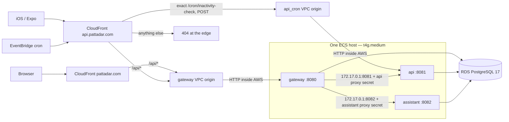

# One-server runtime (Design A)

Decided by Reddy, 26/10/2026: "ok go now, we will see later." Build Design A as
**code only**. Nothing here is applied. No AWS, Terraform plan/apply or deploy
has run, and every live step below needs its own approval.

The gateway, api and assistant move from ECS Fargate behind an ALB to ECS on
**one EC2 `t4g.medium`** (ECS-optimized AL2023 arm64, bridge mode, static host
ports) behind **CloudFront VPC origins**. RDS is unchanged.

## Where it lives

| Part | Code |
|---|---|
| Host, instance role, SG, patching, host probe (IMDS block, disk) | `infra/terraform/modules/runtime/ec2.tf` |
| api distribution, VPC origins, 404/POST-only functions, cron origin policy, us-east-1 cert | `infra/terraform/modules/runtime/api_edge.tf` |
| EC2/bridge task definitions, SSM secrets, services (min 0 / max 100) | `infra/terraform/modules/runtime/ecs.tf` |
| SPA `/api/*` to the gateway VPC origin, SPA bucket `force_destroy` | `infra/terraform/modules/runtime/cloudfront.tf` |
| Alarms: no-running-task ×3, host status ×2, CPU surplus, host unhealthy, RDS ×2, cron ×2 (eleven; the eleventh, about $0.10/month, awaits Reddy); ECS task-stopped rule | `infra/terraform/modules/runtime/observability.tf` |
| api fail-closed ingress | `services/api/src/private_ingress.py`, `services/api/Dockerfile` |
| Split proxy secrets | `services/gateway/src/internal_api.py`, `routes/{proxy,account,capabilities}.py` |
| Release: `--templates`, health gate, cron hold, env gates, rollback-shape check | `scripts/deploy-release.py`, `.github/workflows/deploy.yml` |
| Lifecycle: SSM existence check, CloudFront smoke | `scripts/platform-{up,down}.sh` |
| Edge guard (CI) | `scripts/tests/test_edge_routes.py` |
| $50 budget and anomaly monitor (persistent, code only) | `infra/terraform/modules/persistent/budgets.tf` |

## Decisions (Reddy, 26/10/2026)

1. **Shared host, pre-launch only.** One kernel holds all three tasks,
   including the api's Aadhaar key access. Hard gate: Reddy signs off
   `pattadar-security-review` before any real Aadhaar data reaches the host.
   Launch trigger: turn on GuardDuty Runtime Monitoring for EC2 (about
   $3.6/month), or revert to Fargate.
2. **HTTP from CloudFront to the VPC origin** is a recorded exception. Viewer
   TLS 1.2+ still ends at CloudFront on ACM certificates, and the hop stays
   on the AWS network into a private ENI. The ALB hop it replaces was HTTPS.
3. **Origin response timeout 120 s now, 180 s after a quota request.** The iOS
   synchronous passbook read needs it, and the model budget is 170 s
   (`services/api/src/ai_reading/config.py`). This is a cutover gate. This work
   makes no iOS or Expo code changes.
4. **Deploy blips and host-failure outages are accepted.** Deploys run
   minimum 0 / maximum 100, so each service is out about 1-2 minutes per
   release. A host failure takes everything down for about 5-10 minutes of
   auto-recovery.
5. **App secrets move to SSM SecureStrings created out of band** and never
   enter Terraform state: `/pattadar/<env>/{db-app-password, cron-secret,
   anthropic-api-key, internal-proxy-secret-api,
   internal-proxy-secret-assistant}`. Terraform builds their ARNs as strings.
   The one value in state is `cron-secret`, read by the scheduler's connection
   data source, as before. The persistent Secrets Manager containers are
   **not** deleted in this change.
6. **The dormant web ECS service, task definition and target group are
   removed.** `aws_iam_role.web_task` is kept because the persistent deploy
   role's PassRole names it.

## Cost (estimates, ap-south-1 list prices as of 25/10/2026; not billing)

| Line | $/month |
|---|---|
| Host: t4g.medium on demand ($0.0224/h) | 16.35 |
| Host: 30 GB gp3 root | 2.74 |
| Host: public IPv4 (egress only, no NAT) | 3.65 |
| RDS db.t4g.micro + 20 GiB gp3 | 17.95 |
| Other: KMS, 3 Secrets Manager secrets, Route 53, CloudFront, logs | 7.90 |
| **On demand, after the Secrets Manager cleanup** | **~48.59** |
| On demand until the 4 unused containers are deleted (7 secrets) | ~50.19 |
| With a 1-yr Compute Savings Plan on the instance ($0.0162/h, rate unverified) | ~44.07 |
| With a 1-yr RDS reserved instance ($0.0165/h, about −3.28) | ~45.31 |
| With both commitments | ~40.8 |
| At about 1k users, including the launch WAF | ~70 |

Variable risks:
- The 11 alarms are one over the free 10, about $0.10.
- Unlimited CPU credits cost up to +$46.72 if both vCPUs stay pinned. The
  `host-cpu-surplus-charged` alarm watches for this, and Standard credit mode
  is the hard-cap fallback (Reddy).
- The Fargate + ALB runtime this replaces cost about $45/month more.

Guard, code only and not applied: a $50 monthly budget (90 % actual, 100 %
forecast) and a daily anomaly alert at $5 or more.

## Unproven AWS behaviours and their fallbacks

None of these is proven. The dev proof below settles them before any prod
apply.

| # | Behaviour | Fallback if it fails |
|---|---|---|
| 1 | Two VPC origins on one instance ARN, ports 8080 and 8081 | One gateway VPC origin plus an exact-path, POST-only gateway passthrough for `/cron/inactivity-check` that forwards only `x-cron-secret` and the api secret. That is a backend-contract change, a `test_edge_routes.py` update and a Reddy rewording of invariant 1 |
| 2 | A VPC origin to a **public-subnet** instance with a public IPv4 (AWS documents private subnets) | A public custom origin limited to the CloudFront origin-facing prefix list, plus a secret origin header and TLS on the host; or a private subnet plus NAT (about $41/month, over budget). Reddy picks |
| 3 | Instance replacement: `create_before_destroy` plus `replace_triggered_by` repoint both distributions without `CannotUpdateEntityWhileInUse`; the timing | Treat an instance loss as the Fargate rollback |
| 4 | The 172.17.0.1 host-port path from bridge containers on the AL2023 ECS AMI; the DOCKER-USER IMDS drop surviving a Docker restart | None designed; Design A is blocked, so roll back to Fargate |
| 5 | Registered memory ≥ 3072 MiB on a t4g.medium with `ECS_RESERVED_MEMORY=256` | Smaller per-task memory or a smaller reservation (proposal; t4g.large doubles the instance line) |
| 6 | `runtime_platform` accepted on EC2 task definitions; `imageDigest` reported for EC2 tasks (the release pins rollback images from it) | Drop `runtime_platform` (the AMI is arm64); without digests, rollback pinning needs a deploy-release change |
| 7 | 120 s settable without a quota request (an older repo comment said 60) | Request the quota before cutover |
| 8 | No 502s at a 65 s keep-alive; a 100 MiB upload and SSE chat through CloudFront | Tune the keep-alive or timeouts; uploads already have a size and time limit |
| 9 | Patch Manager on AL2023 updates `ecs-init` and Docker inside the locked release; `amazon-ssm-agent` and `awscli-2` install at first boot | A quarterly AMI refresh as a scheduled, approved replacement |
| 10 | A clean destroy with the service-managed `CloudFront-VPCOrigins-Service-SG` and the VPC-origin ENIs | Re-run `platform-down.sh` (Terraform retries); never delete by hand |

## Disposable dev proof (reserved: Reddy approves, then confirms fresh)

Run `scripts/platform-up.sh dev` for about a day (roughly $2), then
`scripts/platform-down.sh dev`. First create the five `/pattadar/dev/*`
parameters ([account bootstrap](../runbooks/account-bootstrap.md)
§ "App SSM SecureStrings"). Record evidence for each item:

- [ ] Two VPC origins on one instance ARN (8080, 8081) are accepted
- [ ] A VPC origin reaches the public-subnet instance with a public IPv4
- [ ] From inside a task, IMDS times out while task credentials work, and the
      `HostUnhealthy` metric reports 0
- [ ] All three tasks place with `dockerSecurityOptions` `no-new-privileges`
      (the agent registers `ECS_SELINUX_CAPABLE=true`)
- [ ] One ECS task-stopped event and one alarm reach the email subscription
      (after the persistent `EventsUse` KMS statement is applied)
- [ ] CloudFront access logs for both distributions land under
      `cloudfront/` in the access-logs bucket
- [ ] The gateway reaches `172.17.0.1:8081` and `:8082`
- [ ] `describe-tasks` reports `imageDigest` for EC2 tasks
- [ ] Registered memory is ≥ 3072 MiB, and all three tasks place
- [ ] `runtime_platform` is accepted on the EC2 task definitions
- [ ] No 502s at the 65 s keep-alive; a 100 MiB upload and SSE chat work through CloudFront
- [ ] The smoke passes: gateway 401, anonymous `invitePreview` 200 through the api, cron handler 403, `/graphql` 404, all services running
- [ ] Session Manager works with no SSH. Measure the api and gateway boot time
      against the health-check `startPeriod` (estimates: 120 s and 60 s)
- [ ] A release through `deploy-release.py` passes the health gate and the
      rollback-shape check
- [ ] Instance `-replace` and the VPC-origin repoint, timed
- [ ] `platform-down.sh dev` destroys cleanly, with timing

## Apply sequence

| Step | What | Approval |
|---|---|---|
| a | Commit as **two commits**. A is compute-agnostic: private ingress, split secrets, SSM `valueFrom`, db password out of runtime, SPA `force_destroy`, lifecycle SSM checks, release `--templates`, gates, keep-alive. B is compute: `ec2.tf`, `api_edge.tf`, EC2/bridge `ecs.tf`, SG, Route 53, alarms and outputs, ALB removed, smoke. A push to `main` runs Deploy. With prod runtime absent it is expected to fail at Resolve and change nothing | Reddy: push/merge to `main`; `secret-scan` first |
| b | Disposable dev proof (above) | Reddy, reserved; fresh confirmation |
| c | iOS passbook to `/import-passbook-async` (sync-ios, iOS session) and Expo's reads (mobile-feature-delivery), or file the quota request and accept 180 s | Reddy |
| d | Create the five prod SSM SecureStrings | Reddy; `db-app-password` is reserved |
| e | Reviewed `terraform plan` of prod persistent (about 24 pending changes plus the budget) and runtime | Reddy: a plan reads live state |
| f | `scripts/platform-up.sh prod` | Reddy, high risk; fresh confirmation |
| g | Regenerate the release preflight with an EC2/bridge assistant rollback, then re-run Deploy on the head of `main` | Reddy |
| h | `functional-acceptance` end to end: web upload/read/delete, a document read, assistant chat, export/backup, the iOS passbook read; SNS subscription confirmed | Reddy for live data |

## Cutover gates

1. Shared-host `pattadar-security-review` sign-off by Reddy before any real
   Aadhaar data, with the launch trigger named (decision 1).
2. The iOS synchronous passbook read uses the async route, or the 180 s quota
   is granted and Reddy accepts the 10 s margin (decision 3).
3. A digest-pinned EC2/bridge assistant rollback revision with durable-read
   evidence before the first post-cutover Deploy
   ([tested release](../runbooks/tested-release.md)).
4. Every row of the dev proof passed, or its fallback chosen.
5. The persistent CMK key policy admits `events.amazonaws.com` (`EventsUse`,
   in code) and the access-logs bucket admits CloudFront log delivery
   (`CloudFrontAccessLogsDelivery`, in code), both applied. Until then the ECS
   task-stopped rule cannot publish to the encrypted alarm topic and the edge
   keeps no access log.
6. `envs/prod/runtime` exports `task_definition_arns` (it does in code);
   Deploy's Resolve step reads it.

The same list, written as release blockers, is in
[tested-release.md](../runbooks/tested-release.md) § "One-host runtime cutover
gates".

## Rollback to Fargate

1. `git revert` commit B and keep A. The reverted `ecs.tf` brings back
   FARGATE/awsvpc, Service Connect (`API_BASE_URL=http://api:8080`), the ALB
   and its target groups. They now carry the SSM secrets and the split proxy
   secrets, which Fargate supports unchanged.
2. Regenerate the release preflight with a FARGATE-shaped assistant rollback.
   The shape check enforces it.
3. Run a reviewed persistent plan and an approved persistent apply first.
   Reverting B also reverts `modules/persistent`: `s3.tf` gets back the
   `ALBAccessLogsDelivery` grant that the ALB's access logs need (and drops
   `CloudFrontAccessLogsDelivery`), and `kms.tf` drops `EventsUse`. Without
   this, the runtime apply fails when it turns the ALB access logs on.
4. Run a reviewed plan, then an approved runtime apply outside 05:30-06:30 UTC.
   The ECS services are replaced. The ALB, its ap-south-1 certificate and the
   `api` ALB alias return. The api distribution, the VPC origins and the host
   go, and the SPA `/api/*` returns to the `api.pattadar.com` custom origin.
5. Run Deploy.

iOS, Expo and the cron keep their hostnames and paths, and iOS gets the ALB's
200 s back. Expect about 30-45 minutes of work and 10-20 minutes of API
downtime, and about $45/month more.

## Follow-ups (each a separate, approved change)

- Delete the 4 unused Secrets Manager containers (`anthropic-api-key`,
  `cron-secret`, `cognito-config`, `notify-providers`) after copying the values
  to SSM. This is a persistent change and saves about $1.60/month.
- Savings Plan and RI timing. Both are irreversible 1-year commitments and a
  budget decision for Reddy. Buy them only after the dev proof and a stable
  stretch in prod. Verify the $0.0162/h Compute Savings Plan rate first. The
  RDS RI ($0.0165/h) is independent of the host choice and survives a Fargate
  rollback; the instance Savings Plan is a Compute Savings Plan, so it would
  also cover Fargate.
- Apply the persistent KMS `EventsUse` statement and the access-logs bucket's
  `CloudFrontAccessLogsDelivery` statement (both in code; the cutover gate
  above). The same apply drops the dead `ALBAccessLogsDelivery` grant.
- Add a first-ranked WAF allow rule for the exact cron path, with sampling
  off, before `enable_waf` goes on. CloudFront 5xx alarms for the api
  distribution need an SNS topic in us-east-1 (deferred to launch).
- Remove the dead `web_*` variables, `web_origin = "ecs"`, the
  `--web-origin ecs` option.
- Schedule a quarterly AMI refresh (`ignore_changes = [ami]` keeps the host
  on its boot AMI).
